<div align="center">



<br />

[](https://github.com/TIKAxp?tab=repositories)
[](https://github.com/TIKAxp)
[](https://github.com/TIKAxp)

[ABOUT](#about) &nbsp;·&nbsp; [INTERESTS](#what-im-into) &nbsp;·&nbsp; [NOW](#currently-exploring) &nbsp;·&nbsp; [CONTACT](#connect)

</div>

---

<table>
<tr>
<td width="58%" valign="top">

## About

Hey, I'm **SlayerTIKA** — a curious mind from Vietnam who enjoys collecting interesting things, exploring technology, and learning at my own pace.

No expert act. No finished destination. Just curiosity, good finds, and the next thing worth discovering.

</td>
<td width="42%" valign="top">

### Profile card

```text
NAME       SlayerTIKA
ALIAS      TIKA
BASED IN   Vietnam
IDENTITY   Digital explorer
CURRENT    Always learning
MOTTO      Stay curious.
```

</td>
</tr>
</table>

## What I'm into

<table>
<tr>
<td align="center" width="33%"><h3>⌘ Technology</h3><sub>Exploring tools, ideas, and the digital world.</sub></td>
<td align="center" width="33%"><h3>◈ Collecting</h3><sub>Keeping the interesting things I discover.</sub></td>
<td align="center" width="33%"><h3>✳ Gaming</h3><sub>Finding new worlds, stories, and experiences.</sub></td>
</tr>
<tr>
<td align="center" width="33%"><h3>◉ Discord</h3><sub>Interested in communities and bot projects.</sub></td>
<td align="center" width="33%"><h3>▧ Web design</h3><sub>Enjoying creative corners of the internet.</sub></td>
<td align="center" width="33%"><h3>↗ Learning</h3><sub>One new discovery at a time.</sub></td>
</tr>
</table>

## Currently exploring

- New technology and creative tools
- Discord bot ideas and community experiences
- Web design, automation, and the things that spark curiosity

<details>
<summary><strong>More about my mindset</strong></summary>

<br />

> I don't need to know everything to get started. I just need to stay curious enough to take the next step.

</details>

## Connect

<div align="center">

[](https://github.com/TIKAxp)
[](https://github.com/TIKAxp?tab=repositories)
[](https://discord.com/users/718755571699810344)

<br />

**STAY CURIOUS · KEEP EXPLORING · NEVER STOP LEARNING**

<sub>Thanks for stopping by my corner of GitHub.</sub>

</div>
